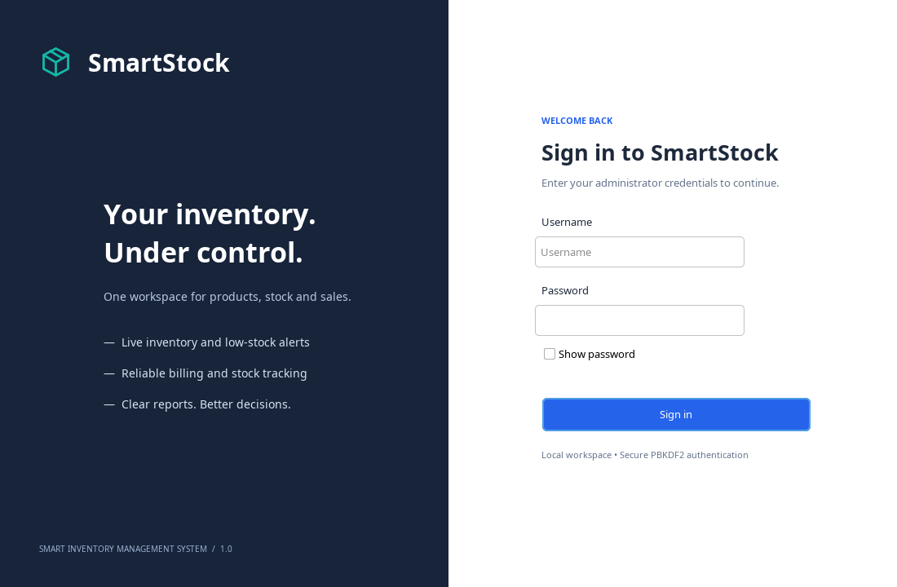
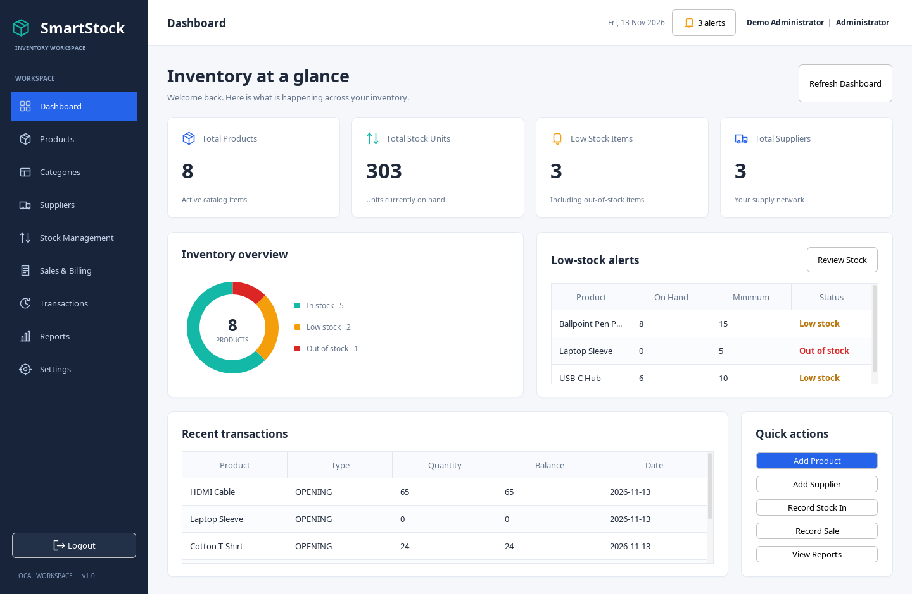
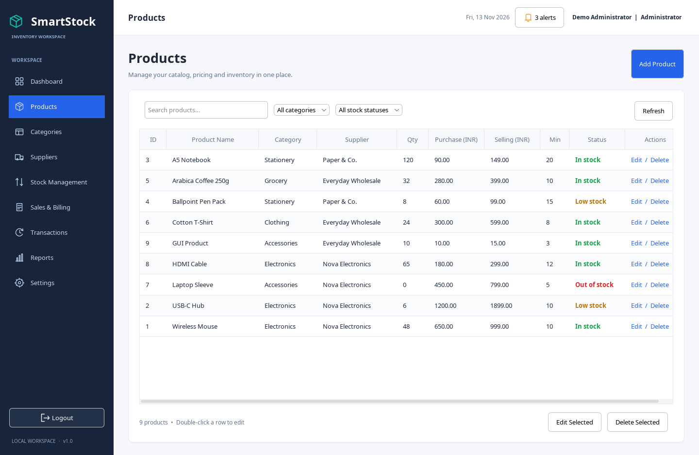
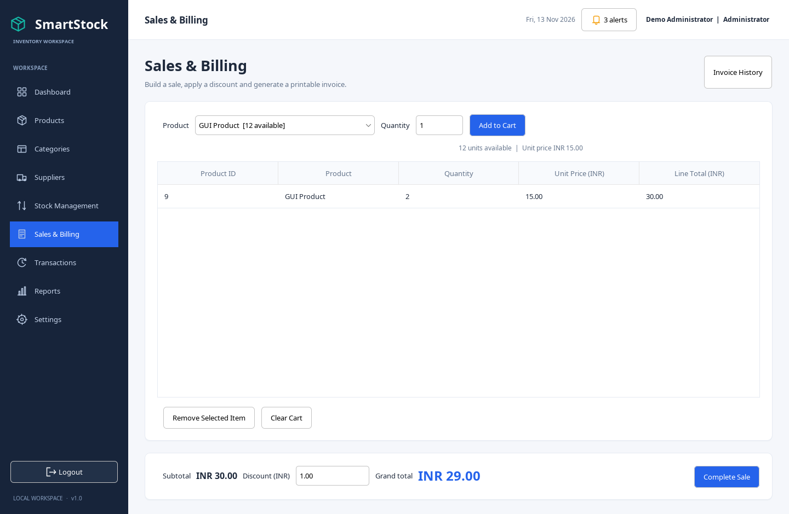
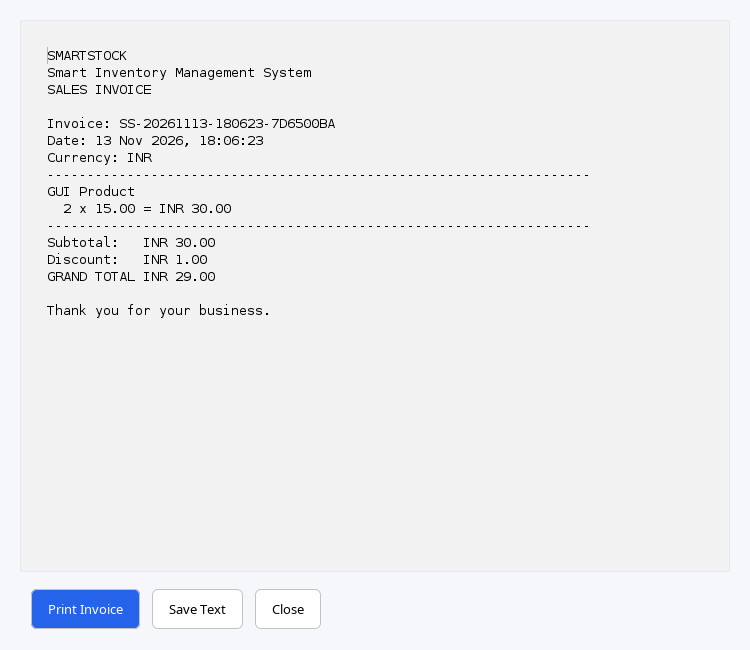

# SmartStock — Smart Inventory Management System

A small desktop inventory system built for a B.Tech project. SmartStock is meant for a retail setup where stock, suppliers, billing and product history all need to stay in one place without relying on a browser or online service.

I kept it focused on the everyday work a small shop actually does: adding stock, tracking sales, checking low inventory and keeping a basic record of what changed and when. **Desktop application, not a website.** The app runs locally with Java 17 or newer and keeps its data in a SQLite database on the machine.

## Quick start

```sh
mvn clean package
java -jar target/SmartStock.jar
```

Alternatively, double-click `run.bat` on Windows or run `./run.sh` on Linux/macOS. These scripts build the project if the JAR is missing. Internet is needed for the first Maven build, not for normal application use.

**Demo account:** username `garvit`, password `garvit@123`.

This demo username and password is public on purpose, so it can be used for a quick test run. If you are storing real business data, change it under **Settings** before continuing. Passwords are stored as PBKDF2 hashes, not plain text.

## Project description and problem statement

In a lot of small shops, stock is still tracked in spreadsheets or notebooks, which makes it easy to lose track of quantities, miss reorders or end up with mismatched billing. This project brings those tasks into one desktop app so the numbers are easier to trust and the stock history is easier to follow.

### Objectives

- Maintain accurate, persistent inventory with searchable product records.
- Track suppliers and categories without broken relationships.
- Prevent negative stock and partially completed sales.
- Generate reusable invoices and database-backed reports.
- Demonstrate Java OOP, Swing, collections, exception handling, JDBC and file handling in a realistic project.

## Completed features

| Module | Functional capabilities |
|---|---|
| Authentication | Empty-input checks, validated admin login, show/hide password, asynchronous password verification, logout and password changes |
| Dashboard | Live product/unit/low-stock/supplier counts, custom stock-level donut chart, five latest movements, low-stock table and five quick actions |
| Products | Add/edit/delete, literal text search, category/status filters, refresh, numeric column sorting, per-row actions, deletion confirmation and below-cost warning |
| Categories | CRUD, case-insensitive duplicate prevention, search, assigned-product counts and protected deletion |
| Suppliers | CRUD, contact details, phone/email validation, search, detail view and foreign-key-protected deletion |
| Stock | Stock in/out, available-balance display, optional reference, no negative stock, transactional stock/audit updates |
| Sales & Billing | Multi-product cart, merged duplicate products, line totals, fixed-amount discount, unique invoices, atomic checkout and stock reduction |
| Invoices | Read-only invoice preview, Java printing, save as UTF-8 text, saved-invoice history and re-opening after restart |
| Transactions | Read-only audit records, product/remarks search, inclusive date range, type filters, clear filters and refresh |
| Reports | Inventory, low stock, suppliers, stock transactions and sales summary; real totals and CSV export with escaping/formula neutralization |
| Settings | Password change, database path, backup guidance, currency and runtime information |

The application uses a light FlatLaf theme, a dark sidebar, original Java2D icons, rounded cards, modern tables and consistent dialogs. The main frame requests maximized startup and supports 1100 × 700; the dashboard scrolls vertically on smaller windows instead of compressing its controls. Your operating system/window manager controls actual maximization.

### Inventory rules

- Quantities and minimum stock are whole numbers from 0 to 1,000,000,000.
- Movement and sale quantities must be positive.
- Prices have at most two decimal places, are non-negative and are capped at INR 1,000,000,000.00 per unit.
- Monetary inputs use `BigDecimal`; database values are integer minor units (paise). For example, INR 149.00 is stored as `14900`. This avoids SQLite binary floating-point errors.
- Individual sale calculations check `long` overflow; report monetary aggregates use `BigInteger`.
- A product is **Low stock** when `quantity < minimumStock`. Zero quantity is **Out of stock** and is also included in dashboard alerts and the low-stock report, even if its minimum is zero.
- Product editor quantity changes create `ADJUSTMENT` audit records. Newly created products create `OPENING` records.
- Stock Out is an unbilled issue. Use Sales & Billing for revenue and invoices.
- Checkout re-reads current prices and available stock from SQLite, rather than trusting stale cart values. Review catalog changes before finalizing a sale.
- Deleting a product keeps historical product names, invoice lines and transactions. Historical foreign keys become `NULL`; category/supplier deletion remains restricted while products reference them.

## Technology stack

| Component | Technology |
|---|---|
| Language | Java 17 source/bytecode target; locally tested on OpenJDK 21 |
| GUI | Java Swing, JTable, Java2D, CardLayout, BorderLayout, GridBagLayout, FlowLayout and BoxLayout |
| Styling | FlatLaf 3.5.4; Segoe UI where available with Java font fallback |
| Database | SQLite through Xerial SQLite JDBC 3.47.1.0 |
| Build | Maven, compiler plugin and Shade executable-JAR packaging |
| Password security | Built-in PBKDF2WithHmacSHA256, 210,000 iterations, 16-byte random salt, 256-bit derived key |
| Tests | JUnit Jupiter 5.11.4, temporary SQLite files and Swing event-dispatch-thread workflow tests |
| Logging dependency | SLF4J no-op provider; no credentials logged |

FlatLaf and SQLite JDBC use permissive open-source licenses; refer to the dependencies' distributed license notices. No image assets or commercial icon sets are required.

## System architecture

```text
Swing panels / dialogs
        |
        v
AppContext (wires shared dependencies)
        |
        +--> AuthenticationService --> JDBC --> admins
        +--> InventoryService ------> JDBC --> products + stock_transactions
        +--> SalesService ----------> JDBC --> products + sales + sale_items + stock_transactions
        +--> CategoryDAO / SupplierDAO / ProductDAO / TransactionDAO / SalesDAO
        +--> ReportService --> DAOs --> CSVExporter
                                      InvoiceFormatter --> InvoiceDialog / Java printing
```

UI classes handle layout and user interaction. DAOs read and persist relational records. Services enforce business rules and own multi-step transactions. All SQL values originating from forms/search are bound with `PreparedStatement`. Fixed schema/PRAGMA statements use `Statement` without user interpolation. JDBC resources use try-with-resources.

### OOP concepts used in actual code

| Concept | Implementation |
|---|---|
| Classes/objects | `Product`, `Category`, `Supplier`, `Sale`, `SaleItem`, `StockTransaction`, `Admin` |
| Encapsulation | Private model attributes with getters; mutable catalog entities expose setters while saved sale snapshots are immutable |
| Inheritance | `Admin extends User`; all screen panels extend `BasePanel` |
| Abstraction | Abstract `User.getRole()` and `BasePanel.refresh()`; generic `CrudDAO<T>` interface |
| Polymorphism | `CrudDAO<Category>` and `CrudDAO<Supplier>` implement CRUD differently; `MainDashboard` calls overridden `refresh()` through `BasePanel` references |
| Overriding | `Admin.getRole()`, DAO implementations, panel refresh methods, icon painting and table rendering |
| Overloading | `ProductDAO.findAll()` / `findAll(String)`, `SalesService.checkout(cart)` / `checkout(cart, discount)`, `ValidationUtil.money(long)` / `money(BigInteger)`, UI helpers |
| Collections | `ArrayList` for carts, report rows and DAO results; `LinkedHashMap` merges cart quantities and preserves navigation order |
| Exceptions | `AppException` for understandable errors; services roll back failures; `UI.safe()` presents error dialogs |

## Database architecture

Logical database name: **smart_inventory**. SQLite file: **smart_inventory.db**.

| Table | Main columns and relationships |
|---|---|
| `admins` | `id`, unique `username`, `display_name`, `password_hash` |
| `categories` | `id`, unique case-insensitive `name` |
| `suppliers` | `id`, unique `name`, `contact_person`, `phone`, `email`, `address` |
| `products` | `id`, unique `name`, `category_id`, `supplier_id`, `quantity`, `purchase_cents`, `selling_cents`, `min_stock`, `description` |
| `stock_transactions` | Product FK + historical name, type, quantity, before/after stock, local timestamp, remarks |
| `sales` | Unique invoice number, local timestamp, subtotal/discount/total minor units |
| `sale_items` | Sale FK, nullable product FK + historical name, quantity, captured unit price and line total |

Relationships:

```text
categories 1 ----- * products * ----- 1 suppliers
                         |
                         +----- * stock_transactions
                         |
                         +----- * sale_items * ----- 1 sales
```

Foreign keys are enabled on **every connection**, with a five-second busy timeout. Database checks prevent negative stock/amounts and invalid invoice totals. Category/supplier/product lookup, transaction date and sales lookup indexes support common queries.

### Initialization and data location

The schema is automatically loaded from `src/main/resources/schema.sql`. An identical reviewable copy is supplied at `database/schema.sql`. You do not need to run SQL manually. Keep both files synchronized when changing the schema.

On first launch the application creates its data directory, tables, demo administrator and realistic demo inventory. Inventory examples are seeded only if the catalog and audit tables are empty; restarting does not duplicate or replenish data.

Default locations:

- **Windows:** `%LOCALAPPDATA%\SmartStock\smart_inventory.db`
- **Linux:** `$XDG_DATA_HOME/SmartStock/smart_inventory.db`, or `~/.local/share/SmartStock/smart_inventory.db`
- **macOS:** `~/Library/Application Support/SmartStock/smart_inventory.db` (unless `XDG_DATA_HOME` is set)

Use an isolated database for demonstrations:

```sh
java -Dsmartstock.db=/absolute/path/demo.db -jar target/SmartStock.jar
```

**Backup:** close the application, then copy the database file. Restore only while the application is closed. The database is not encrypted; protect it with operating-system permissions. Never publish real database files to GitHub.

## Project folder structure

```text
smart-inventory-management-system/
├── pom.xml
├── run.sh / run.bat
├── README.md
├── VIVA_PREPARATION.md
├── TEST_REPORT.md
├── .gitignore
├── .github/workflows/java-ci.yml
├── database/schema.sql
├── screenshots/                     # Real Swing screenshots captured during testing
└── src/
    ├── main/
    │   ├── java/com/smartstock/
    │   │   ├── Main.java
    │   │   ├── config/              # SQLite connections and first-run initialization
    │   │   ├── model/               # Encapsulated domain objects
    │   │   ├── dao/                 # JDBC data access and CRUD interface
    │   │   ├── service/             # Authentication, inventory, checkout and reports
    │   │   ├── ui/                  # Frames, dialogs, styling and dependency wiring
    │   │   │   └── panels/          # Nine functional navigation screens
    │   │   └── util/                # Validation, password hashing, CSV and invoices
    │   └── resources/schema.sql
    └── test/java/com/smartstock/
        ├── InventoryIntegrationTest.java
        └── DesktopWorkflowTest.java
```

## Screenshots

These are captures of the running Java application, not mockups.

### Login


### Dashboard


### Product management


### Sales and billing


### Printable invoice


More captures, including transactions, reports and the minimum-size layout, are in `screenshots/`.

## Installation and running

### Requirements

1. A **desktop** Java JDK/JRE 17 or newer; a headless-only runtime cannot display Swing windows.
2. Maven 3.8+ to build from source.
3. Internet on the initial build to fetch dependencies from Maven Central.
4. A graphical Windows, Linux or macOS session. No MySQL server or database password is needed.

Verify tools:

```sh
java -version
mvn -version
```

### Build from source

```sh
cd smart-inventory-management-system
mvn clean package
java -jar target/SmartStock.jar
```

`target/SmartStock.jar` is a shaded executable containing its dependencies. Do not launch `original-SmartStock.jar`. The final JAR is approximately 15 MB because it includes SQLite's cross-platform native libraries. A Java runtime is still required; it is not bundled.

In VS Code, open this project folder and install the **Extension Pack for Java**. Let Maven resolve the project, then run `com.smartstock.Main` or use the terminal commands above.

### Demonstration walkthrough

1. Sign in using the documented demo account.
2. Show live dashboard counts and the stock chart.
3. Add a category and supplier, then create a product linked to them.
4. Search and filter products; edit price or minimum stock.
5. Record a stock-in and a stock-out, then demonstrate rejection of an excessive issue.
6. Open Sales & Billing, add two products, enter quantities and an optional **fixed INR discount**, and complete the sale.
7. Preview the invoice; save a text copy or use the system print dialog. Use the OS PDF printer if available.
8. Inspect the SALE and stock movement audit records in Transactions.
9. Generate each report and export a CSV.
10. Restart the application to demonstrate persistence; re-open the invoice through Invoice History.
11. Show Settings and log out.

### Functional entry points

This is a desktop program and has no HTTP URIs or production website URL.

- Application entry: `com.smartstock.Main`, or `java -jar target/SmartStock.jar`.
- Runtime option: `-Dsmartstock.db=/path/to/database.db` before `-jar`.
- Sidebar: Dashboard, Products, Categories, Suppliers, Stock Management, Sales & Billing, Transactions, Reports and Settings.
- Logout returns to the login frame and discards the unsaved cart.

## Testing

**Latest sandbox verification: 30 tests passed, 0 failed, 0 errors, 0 skipped**, including 27 integration tests and three graphical/printing tests. Full details and limitations are in [TEST_REPORT.md](TEST_REPORT.md).

```sh
mvn test
```

Without a display, graphical tests are explicitly skipped; this is not evidence of a GUI pass. On Linux CI, run:

```sh
sudo apt-get install xvfb xauth
xvfb-run -a -s '-screen 0 1600x1100x24' mvn -Djava.awt.headless=false clean package
```

A desktop-capable JDK/JRE must be installed. Reports appear in `target/surefire-reports/`; actual Swing screenshots are regenerated in `target/gui-screenshots/`.

The included GitHub Actions workflow builds on Java 17 and uploads the JAR, test results and screenshots **when this folder is used as the repository root**. That remote workflow has not been run merely by creating this project.

### Troubleshooting

- **`mvn` not found:** install Maven and put its `bin` folder on PATH; reopen your terminal.
- **Unsupported class version:** install Java 17+ and confirm your terminal/IDE use the same JDK.
- **HeadlessException / DISPLAY errors:** run on a graphical desktop; Xvfb is for automated Linux testing only.
- **Database cannot initialize:** check the path in the error and directory permissions; try the custom database option.
- **Database busy:** close other application instances and retry. This edition is designed for a small, local workspace.
- **CSV/invoice cannot save:** choose a writable path; confirm overwrite only when intended.
- **No printer:** save the invoice as text, or configure an OS PDF printer. Physical printer output was not tested in the sandbox.
- **Changed demo password:** use your replacement password. To reset only a disposable demo database, close SmartStock and move that database aside; never delete a real database to recover an account.

## Known limitations and future improvements

This delivery deliberately prioritizes a working one-day academic submission:

- One local administrator workspace; no role-based multi-user system, login throttling, password recovery or encrypted database.
- No cloud synchronization, web deployment, MySQL backend, barcode scanner, purchase-order workflow or multi-warehouse support.
- No GST/tax, returns/refunds, credit sales or accounting integration. Discount is an amount, not a percentage.
- No built-in PDF library; invoices use Java printing/text export and an OS PDF printer where available.
- Reports load local data into memory; huge production datasets would need paging, background database workers and optimized aggregate queries. Routine local CRUD currently executes on the Swing EDT; PBKDF2 login verification uses `SwingWorker`.
- No installer or bundled JRE. Native Windows/macOS execution and physical printers were not tested in this Linux sandbox.
- Schema creation is idempotent but there is no versioned migration engine yet.

Recommended next steps are barcode support, tax-aware invoices, pagination/background loading, role-based access, audited returns and a platform-specific `jpackage` installer.

## Author 
GARVIT WADHAWAN |
ANSH SINGH |
MENAL RANA|
DEEPANSHU RAJ 
